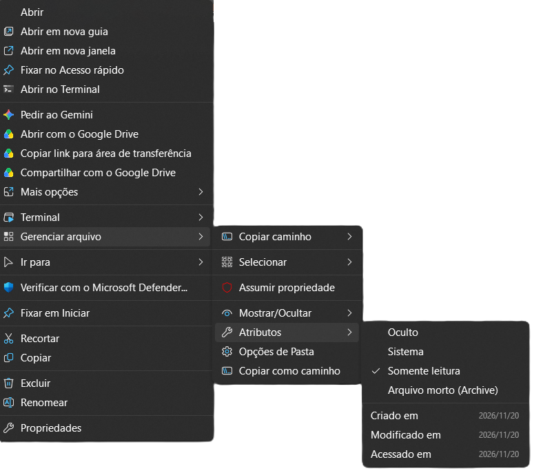
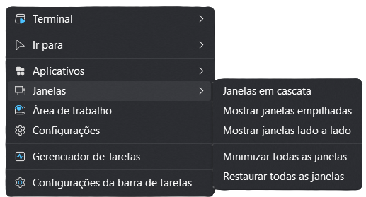

# Nilesoft Shell — Tradução PT-BR

Tradução completa para o Português do Brasil dos menus de contexto, submenus e barra de tarefas do **Nilesoft Shell**.

## Prévia

  
  &nbsp;&nbsp;
  

## O que está traduzido

* Menus de desenvolvimento, gerenciamento de arquivos, atalhos de navegação ("Ir Para"), barra de tarefas e comandos de terminal.

## Como instalar

1. Baixe e extraia os arquivos do repositório.
2. Acesse a pasta de instalação do **Nilesoft Shell** (geralmente em `C:\Program Files\Nilesoft Shell`).
3. Recomenda-se fazer um backup da pasta `imports` atual.
4. Substitua os arquivos na pasta `imports` pelos arquivos `.nss` traduzidos.
5. Execute o `shell.exe` como administrador e clique em **Restart**.

## Créditos

* [Nilesoft Shell](https://nilesoft.org)
